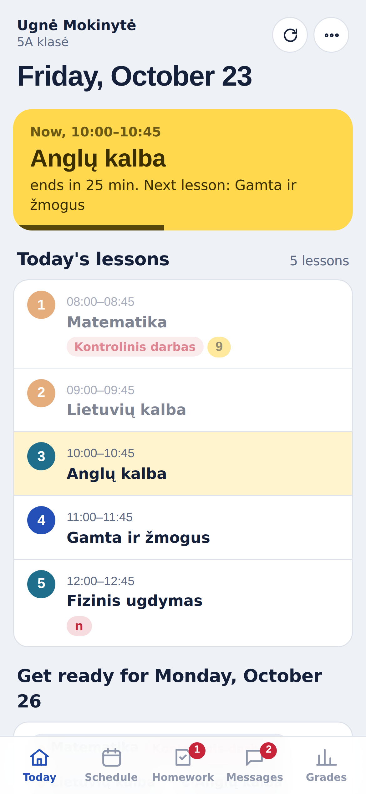
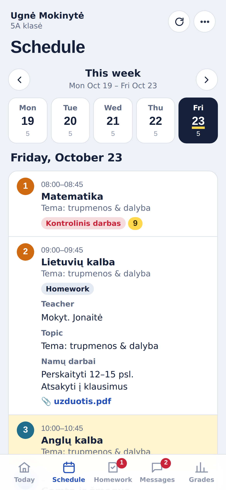
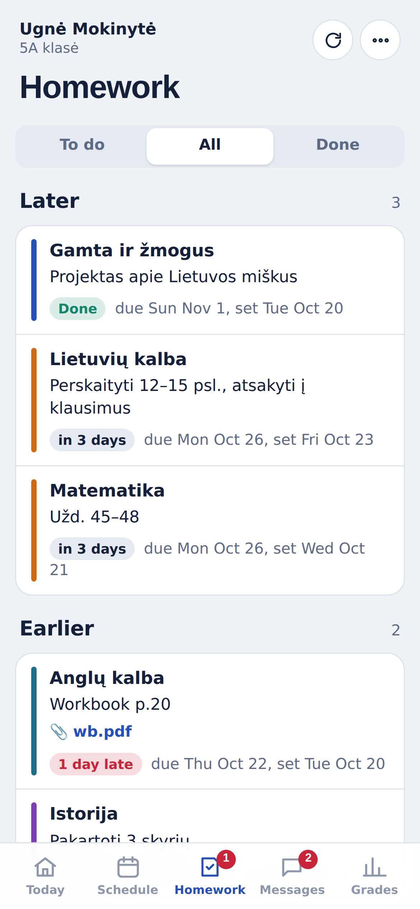
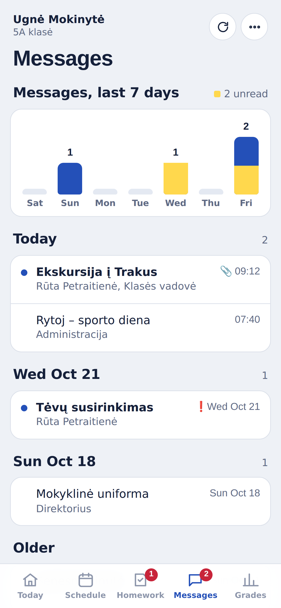
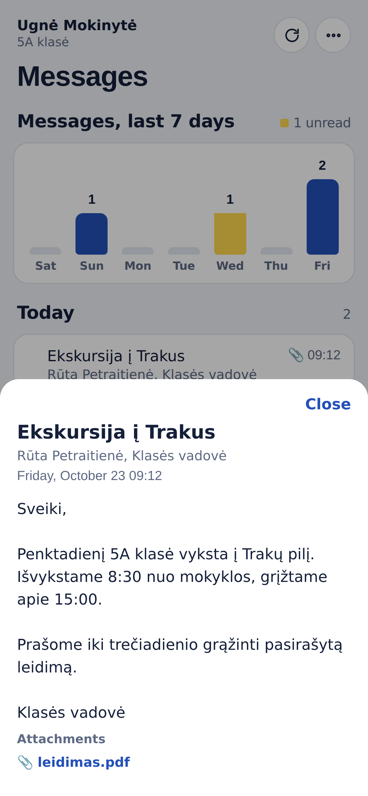
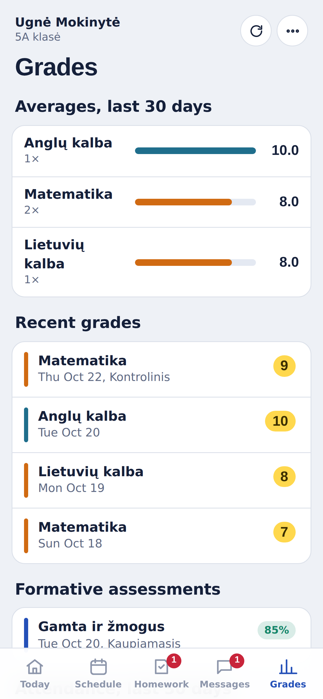
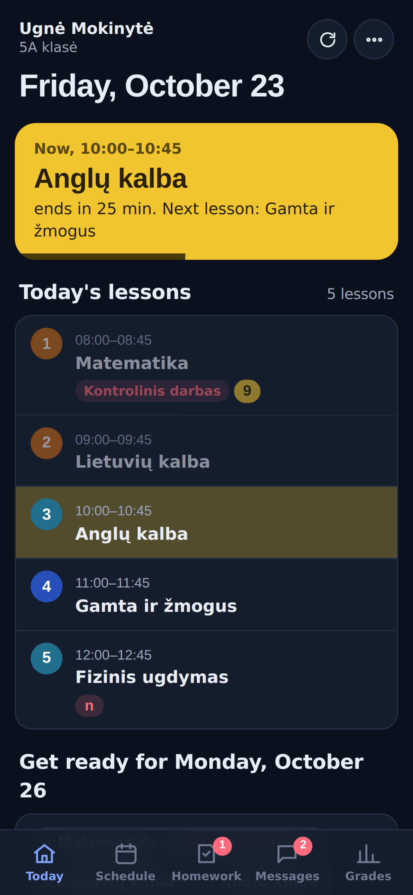
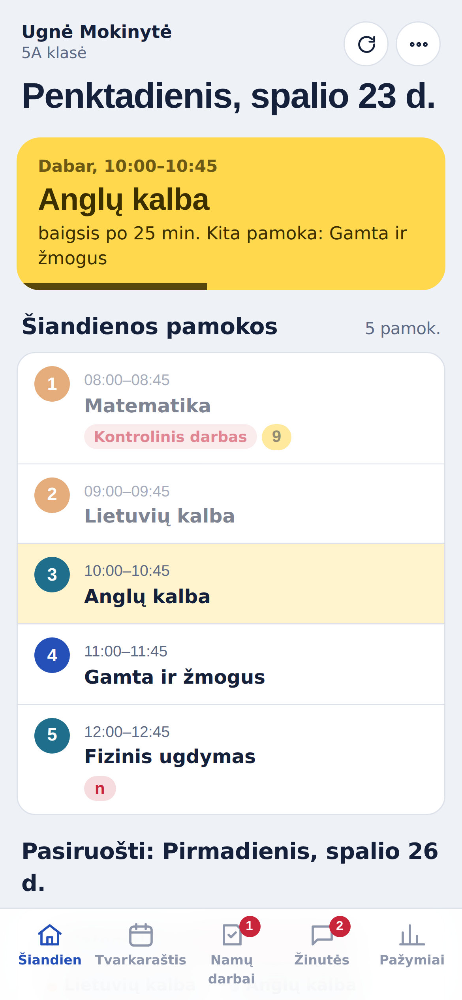

# Dienynas+

A faster, cleaner way to follow your child's school day in the **TAMO dienynas**, the Lithuanian school e-diary, built as a single [Scriptable](https://scriptable.app) script for iPhone.

The official TAMO website and app spread the important things across many screens. Dienynas+ puts what a parent checks every day on one screen: what's happening now, what to prepare for tomorrow, what homework is due, and what the school wrote today.

  
  
  

> Screenshots use made-up sample data. No real pupil, teacher or school appears in them.

## Key features

### Today: the whole school day on one screen

- **Now and next.** A yellow card shows the lesson in progress with a progress bar and minutes left, or the next lesson and when it starts. It updates every minute while the app is open.
- **Today's lessons** with times, test labels (e.g. *Kontrolinis darbas*), grades and absences given in each lesson. Finished lessons fade out.
- **Get ready for the next school day.** Tomorrow's subjects (or Monday's, on a Friday) as a packing list, with any tests flagged and the homework due that day.
- **Homework to do**, today's **messages**, upcoming **tests and checks** for the next two weeks, and **what's new this week**: grades, formative assessments, absences, praise and remarks.
- School holidays and breaks appear as a banner.

 

### Schedule

- Week view with the number of lessons per day. Move between weeks with the arrows; other weeks load on demand.
- Tap any lesson to expand it: teacher, topic, homework set in that lesson, attachments (opened in-app), and the subject average.
- Each subject keeps the same colour everywhere in the app, so Matematika always looks like Matematika.

 

### Homework

- Grouped by due date: **Later**, **Later this week**, **Due tomorrow**, **Due today** and **Overdue / Earlier**, with the latest due date at the top.
- **To do / All / Done** filter. Overdue work is marked in red with how many days late it is; work due soon is highlighted.
- Shows when each assignment was set and when it's due, plus any attached files.
- Teachers' placeholder entries ("-", "x") are hidden.

 

### Messages

  
  

- **Messages per day for the last 7 days** as a bar chart. The yellow part of each bar is unread messages. Tap a day to see only that day's messages.
- Messages grouped by day (Today, Yesterday, then by date), with unread dots, attachment and importance markers. Class group messages are included.
- Tap a message to read it in a sheet; links and attachments open in-app.

### Grades

- **Subject averages for the last 30 days**, calculated from numeric grades, with a bar for each subject.
- Recent grades, formative assessments (*kaupiamieji*), and an attendance summary with absences and late arrivals.

 

### Also

  
  

- **Lithuanian and English** interface, switchable in the ••• menu.
- **Dark mode** follows the iPhone setting.
- **Several children on one account:** the app asks whose diary to show and remembers the choice; switch any time from the ••• menu.
- **Home-screen widget** with the current or next lesson, homework due tomorrow and today's messages. Tapping it opens the app.
- **Works offline.** The last loaded data is shown straight away and refreshed in the background. If TAMO can't be reached, the saved data stays on screen with a note saying when it's from.
- Behaves like a native app: no pinch or double-tap zoom.

## Install

1. Install [Scriptable](https://apps.apple.com/app/scriptable/id1405459188) from the App Store.
2. In Scriptable, tap **+**, name the script `Dienynas`, and paste in the contents of [`Dienynas.js`](Dienynas.js).
3. Run it and sign in with your TAMO username and password.
4. Optional widget: long-press the home screen, add a **Scriptable** widget (small or medium), edit it, and choose **Dienynas** as the script.

To update, replace the script's contents with the latest `Dienynas.js`.

## How it works

Dienynas+ talks directly to the same API the official **TAMO IŠMANIEMS** mobile app uses (`api.tamo.lt` and `dienynas.tamo.lt/MobileServiceV3`) rather than scraping web pages, which makes it faster and less likely to break when the website changes.

| Data | Source |
| --- | --- |
| Sign-in | `MobileServiceV3/AuthenticateV2`, then `core/app/roles` to pick the child |
| Schedule and lesson details | `v2/app/calendar/events` (this week and next) |
| Homework | `core/app/darbai?workType=home` (3 weeks back, 4 weeks ahead) |
| Grades and attendance | `core/app/dienynas` (last 30 days) |
| What's new | `core/app/feeds` |
| Holidays and school events | `core/app/calendar/events/allDay` |
| Messages | `messaging/messages/received` and `messaging/messages/group/received` |
| Attachments | `files/filedownloadurl` / `GetFileUrl` |

Everything is in one file. The data layer runs in Scriptable; the interface is an HTML page shown in Scriptable's WebView, and the two communicate through `tamo://` links intercepted by the script.

## Privacy and security

- Your username and password are stored only in the **iOS Keychain** on your phone. They are never written into the script.
- The script talks only to TAMO's own servers. There is no analytics, tracking or third-party server.
- The last loaded data is cached in Scriptable's local documents folder so the app and widget open instantly. **Sign out and forget password** in the ••• menu deletes the credentials, the session and the cache.
- Dienynas+ is **read-only** with one exception, the same as the official app: **opening a message marks it as read** in TAMO.

## Limitations

- **Unofficial.** This project is not affiliated with TAMO. TAMO's [terms of use](https://content.tamo.lt/taisykles/naudojimo.html) don't cover third-party clients, so use it only with your own account and at your own risk.
- Some data may require an active **TAMO IŠMANIEMS** subscription on the account.
- The API is undocumented and can change without notice. If a section fails to load, the app says which one in a red banner and shows the rest.
- Homework can't be ticked as done from the app; TAMO only allows that for pupils' own logins.

## Credits

- [sobakintech/tamo-dienynas-api](https://github.com/sobakintech/tamo-dienynas-api) (MIT): the reverse-engineered TAMO API reference this app is built on.
- [sobakintech/tamo-dienynas-mcp](https://github.com/sobakintech/tamo-dienynas-mcp) (AGPL-3.0): response-mapping approach that the data layer's mappers are adapted from.
