<div align="center">

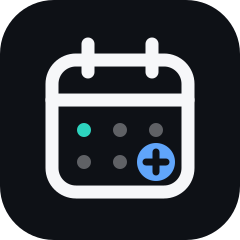

# Dienynas+

**Messages. Homework. Calm.**

A faster, cleaner way to follow your child's school day in the TAMO dienynas, the Lithuanian school e-diary.<br>An iPhone and iPad app for [Scriptable](https://scriptable.app). One file, no server, no sign-up.

[](CHANGELOG.md)
[](https://apps.apple.com/app/scriptable/id1405459188)
[](#ai)
[](docs/BLUEPRINTS.md)
[](https://github.com/gadominas/Tamo-/commits)
[](LICENSE)

</div>

<p align="center">
  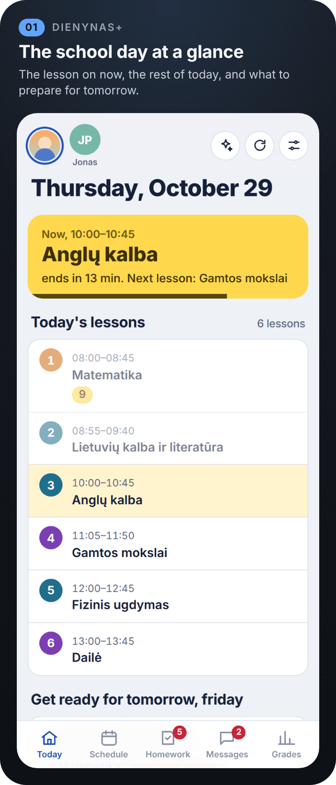
  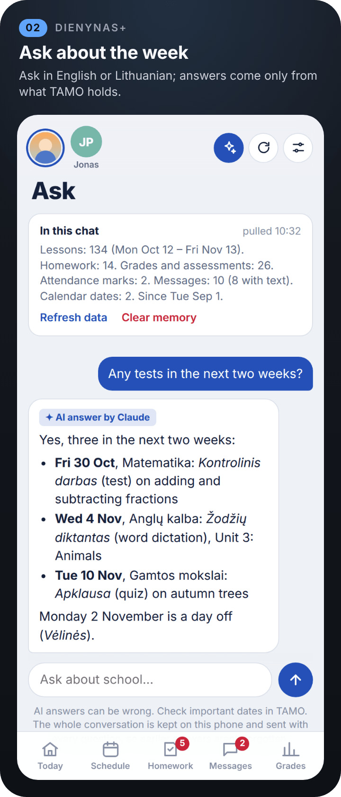
  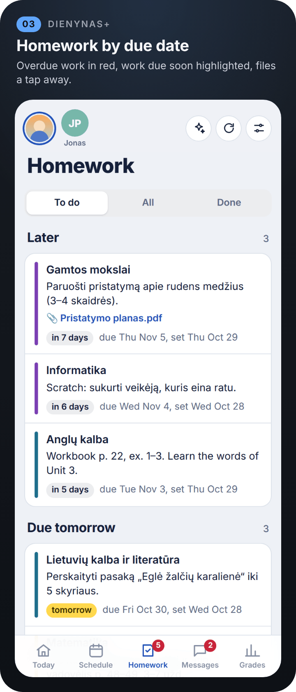
</p>

> [!NOTE]
> Screenshots are rendered from the app's real interface with invented sample data. No real pupil, teacher or school appears in them. School content stays in Lithuanian, as TAMO writes it; the update sheet shows an example offer.

> [!IMPORTANT]
> **Unofficial.** Not affiliated with TAMO. Use it only with your own account and at your own risk. See [Disclaimer](#disclaimer).

## Highlights

- **Today on one screen.** The lesson in progress with minutes left (or the next one), today's lessons, what to prepare for the next school day, homework to do, today's messages, upcoming tests and what's new this week.
- **✨ Ask about the week.** Ask in Lithuanian or English: *What's due tomorrow?* The answer comes only from the school data TAMO has for your child.
- **Homework by due date.** Grouped from Later to Overdue, with days left, files and a To do / All / Done filter.
- **Schedule.** The week with lessons per day; tap a lesson for its teacher, topic, homework, attachments and subject average.
- **Messages.** A bar chart of the last 7 days with the unread part in yellow, messages grouped by day, and each message in a sheet.
- **Grades.** Subject averages for the last 30 days on your school's grade scale (1–10, 1–7 or any other), recent grades, formative assessments and attendance.
- **Children at the top.** With several children, the header shows just their round photos (initials and a short first name until a photo is added), so up to four fit; tap one to switch. The header shrinks as you scroll.
- **🔔 Scheduled checks.** Run it from Shortcuts to be told about new homework, grades, messages and teacher notes; everything announced stays on Today until you mark it as seen.
- **Lithuanian and English.** The interface, the widget and the alerts follow the language set in Settings.
- **Home Screen widget.** The lesson now or next, homework due tomorrow, today's messages and the rest of the day, without grades or message text.
- **Launch screen, Settings and dark mode.** The calendar logo draws itself on start; six palettes or Auto, three layouts, text size and headline font.
- **Updates itself.** A new version offers itself with its three best features; your sign-in, settings and chats are kept.

## Screenshots

<p align="center">
  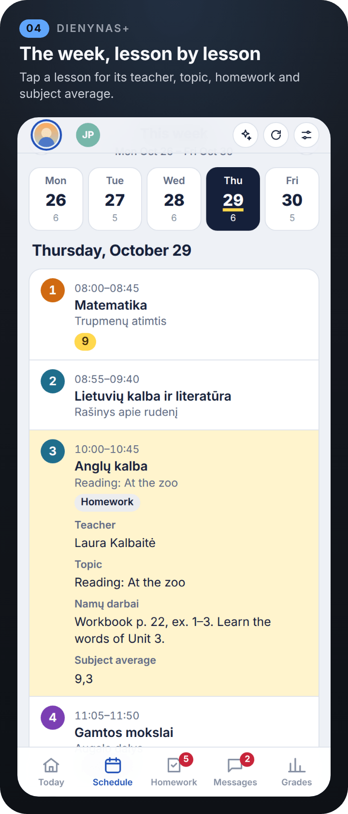
  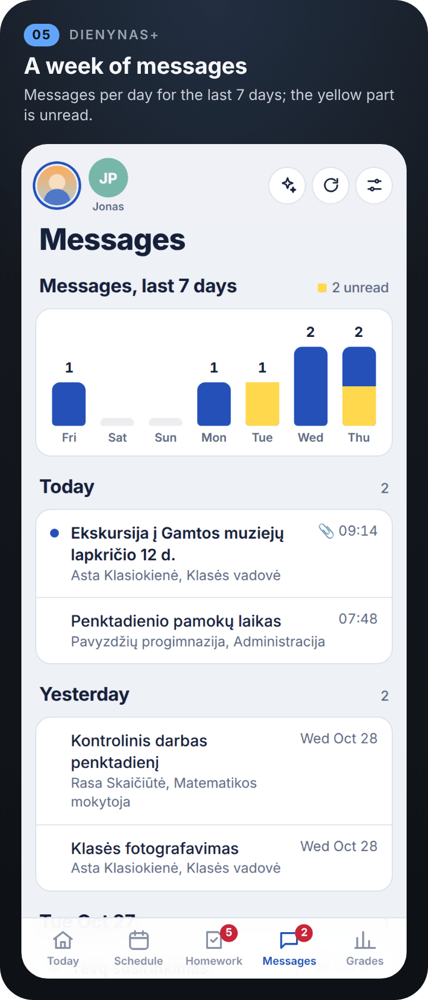
  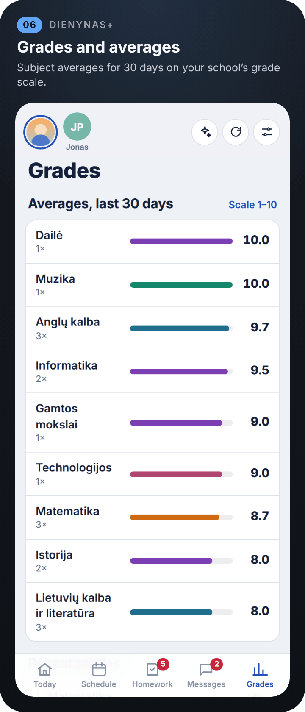
</p>
<p align="center">
  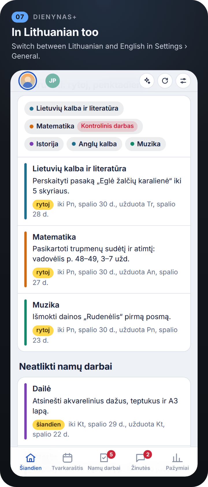
  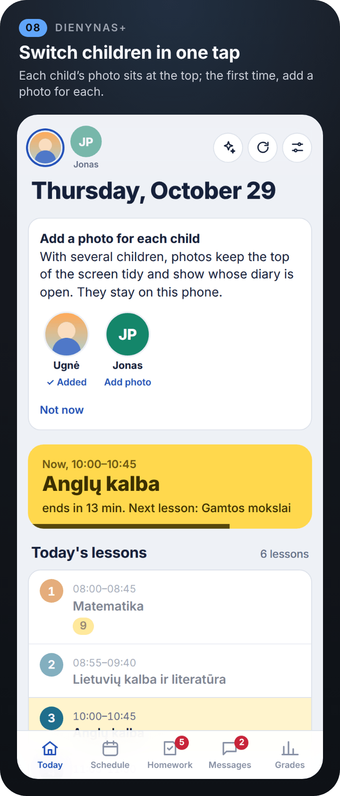
  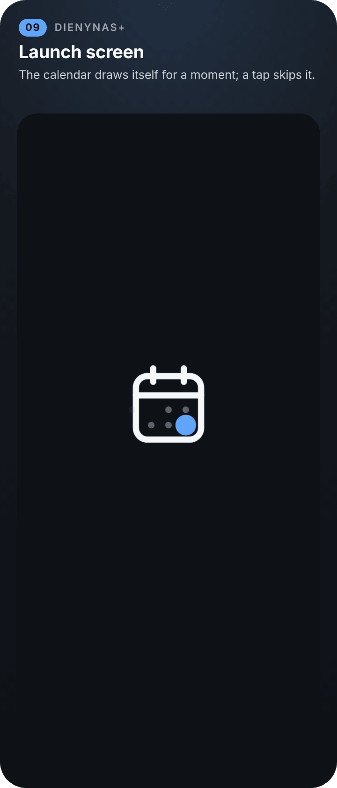
</p>
<p align="center">
  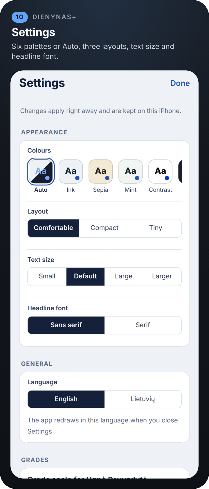
  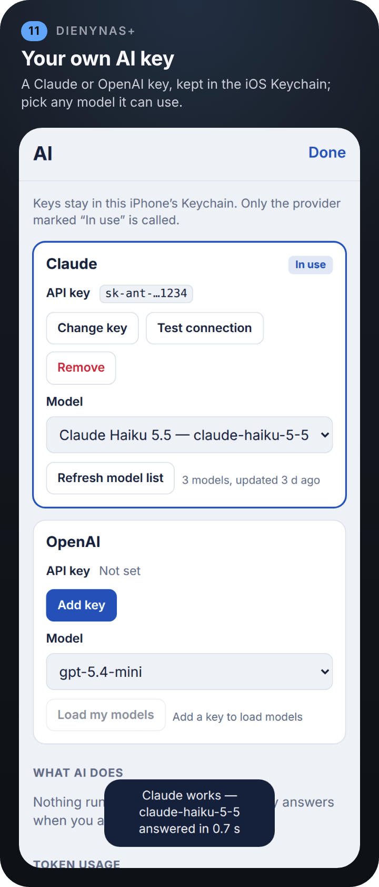
  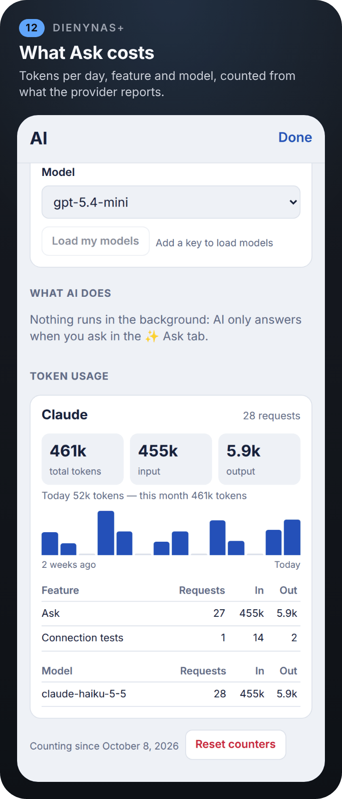
</p>
<p align="center">
  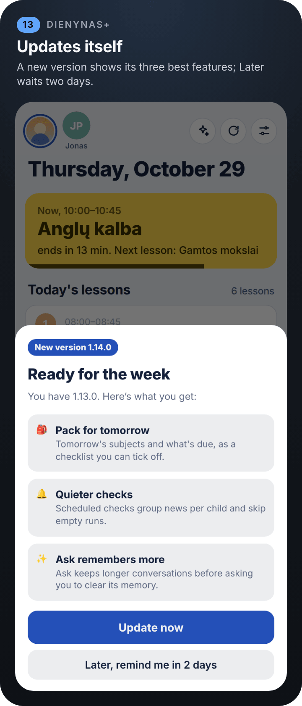
  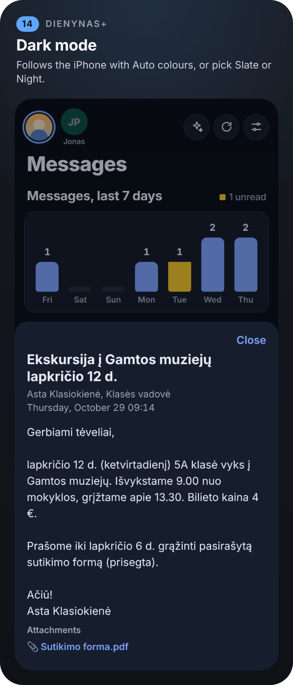
  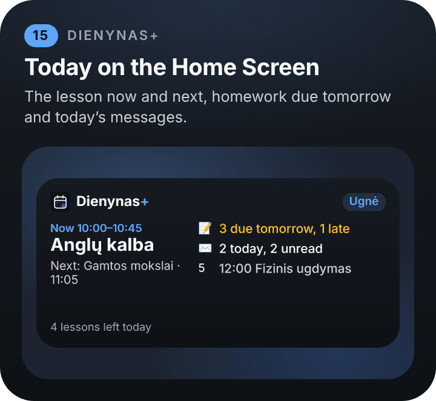
</p>

## Install

1. Get **[Scriptable](https://apps.apple.com/app/scriptable/id1405459188)** (free) on your iPhone or iPad.
2. In Scriptable, tap **+**, paste these two lines, name the script *Dienynas Installer*, and tap **▶**:
   ```js
   const code = await new Request("https://raw.githubusercontent.com/gadominas/Tamo-/master/install.js").loadString();
   await eval("(async () => {" + code + "\n})()");
   ```
3. Tap **Open Dienynas** and sign in with your TAMO username and password. They're kept in the iOS Keychain.

To update, tap **Update now** when Dienynas offers a new version, or run *Dienynas Installer* again. Your sign-in, settings and chat history are kept.

<details>
<summary><b>Install by hand</b></summary>

Rather not use the loader? Paste [`install.js`](install.js) or [`Dienynas.js`](Dienynas.js) into a new script in Scriptable yourself.

</details>

What else you need:

- **A TAMO parent or pupil login.**
- **For ✨ Ask (optional):** a [Claude](https://console.anthropic.com/settings/keys) or [OpenAI](https://platform.openai.com/api-keys) API key, added in **Settings › AI settings**.
- **For 🔔 new-items alerts (optional):** a Shortcuts automation running **Dienynas** with the parameter `check` ([setup](#-scheduled-checks-get-told-about-anything-new)).

## How to use it

The official TAMO website and app spread the important things across many screens. Dienynas+ puts what a parent checks every day on one screen: what's happening now, what to prepare for tomorrow, what homework is due, and what the school wrote today. And when you'd rather just ask, **✨ Ask** answers questions about the school week in Lithuanian or English.

### Today: the whole school day on one screen

- **Now and next.** A yellow card shows the lesson in progress with a progress bar and minutes left, or the next lesson and when it starts. It updates every minute while the app is open.
- **Today's lessons** with times, test labels (e.g. *Kontrolinis darbas*), grades and absences given in each lesson. Finished lessons fade out.
- **Get ready for the next school day.** Tomorrow's subjects (or Monday's, on a Friday) as a packing list, with any tests flagged and the homework due that day.
- **Homework to do**, today's **messages**, upcoming **tests and checks** for the next two weeks, and **what's new this week**: grades, formative assessments, absences, praise and remarks.
- School holidays and breaks appear as a banner.

### Schedule

- Week view with the number of lessons per day. Move between weeks with the arrows; other weeks load on demand.
- Tap any lesson to expand it: teacher, topic, homework set in that lesson, attachments (opened in-app), and the subject average.
- Each subject keeps the same colour everywhere in the app, so Matematika always looks like Matematika.

### Homework

- Grouped by due date: **Later**, **Later this week**, **Due tomorrow**, **Due today** and **Overdue / Earlier**, with the latest due date at the top.
- **To do / All / Done** filter. Overdue work is marked in red with how many days late it is; work due soon is highlighted.
- Shows when each assignment was set and when it's due, plus any attached files.
- Teachers' placeholder entries ("-", "x") are hidden.

### Messages

- **Messages per day for the last 7 days** as a bar chart. The yellow part of each bar is unread messages. Tap a day to see only that day's messages.
- Messages grouped by day (Today, Yesterday, then by date), with unread dots, attachment and importance markers. Class group messages are included.
- Tap a message to read it in a sheet; links and attachments open in-app. Opening a message marks it as read in TAMO.

### Grades

- **Subject averages for the last 30 days**, calculated from numeric grades, with a bar for each subject.
- **Grade scale per child.** Most Lithuanian schools grade 1–10, but some use 1–7. Tap **Scale 1–10** on the Grades tab (or **Settings › Grades**) to pick 1–10, 1–7, 1–5 or any other top grade. Each child keeps their own setting, and averages, bars and ✨ Ask all use it.
- Recent grades, formative assessments (*kaupiamieji*), and an attendance summary with absences and late arrivals.

### ✨ Ask: chat about the school week

Tap ✨ in the top bar and ask in your own words, in Lithuanian or English:

- *What's due tomorrow?* *Ar per dvi savaites bus kontrolinių?* *What should go in the school bag on Monday?*
- *Summarise today's messages.* *Who teaches English?* *How are the maths grades going?*

The assistant is told to answer only from the school data, never to invent dates, grades or tasks, and to say so when something isn't there. It judges grades on the child's own scale (1–10, 1–7, …). Lithuanian school text is quoted as written, with a short translation when you ask in English. ✨ Ask can be wrong like any AI assistant: check important dates in TAMO.

<details>
<summary><b>What Ask reads, and how it remembers</b></summary>

**It pulls everything first.** When you open Ask, the app gathers all the school data TAMO offers for that child and shows what the chat now knows:

- lessons for five weeks (two back, this week, two ahead), with topics, tests and notes
- all homework since 1 September, plus what was done in class over the last five weeks
- all grades, formative assessments and attendance marks since 1 September
- the school calendar, notices, and messages from the last 60 days, including the text of messages that were already read (unread ones stay unread)

The data is refreshed automatically when it's more than a few hours old or from a previous day, or any time with **Refresh data**. How far back and ahead it reads is set in **Settings › What Ask reads**.

**It remembers the conversation.** Every question is sent together with the whole conversation so far, so follow-ups like "and what did we decide?" work. The conversation is saved on the phone, separately for each child, and is still there next time you open the app. **Clear memory** (tap twice) deletes it and starts over.

Because every question carries the school data and the whole conversation, a question costs roughly a cent or two.

</details>

### 🔔 Scheduled checks: get told about anything new

Run the script on a schedule and it tells you what's new since the last check:

- 📝 new homework
- ⭐ new grades and formative assessments
- ✉️ new messages
- 🗒 teacher notes: praise, remarks, comments, absences and late marks

**If the script runs in the Scriptable app**, the news appears as a **popup alert** with an **Open** button. **If Shortcuts runs it in the background**, iOS doesn't allow alerts, so the same list arrives as a **notification**; tapping it opens the app. The text is also returned as the Shortcut output, so a **Show Alert** or **Show Result** action can display it too.

Opening the app or tapping Refresh also pops up anything new since the last run, inside the app. Nothing is repeated: once an item has been shown, it won't come up again, and nothing older than 21 days is announced. The very first check only records what's already there.

**Nothing lives only in the popup.** Every announced item stays at the top of Today under **New since last check** until you tap **Mark all as seen**. Tap a message to open it, or a grade or homework item to jump to its tab; teacher notes and absences show their full text right there.

**Set it up in Shortcuts:**

1. Open **Shortcuts** → **Automation** → **+** → **Time of Day** (for example 15:00 and 20:00 on school days) → **Run Immediately**.
2. Add the action **Scriptable › Run Script**, choose **Dienynas**, and set **Parameter** to `check`.
3. Choose how you want to see the news:
   - **Run In App** on: Scriptable opens and shows the popup alert.
   - **Run In App** off: it runs silently in the background and sends a notification. Allow notifications for Scriptable when iOS asks.

You can also start a check from a link or another app: `scriptable:///run/Dienynas?check=1`.

Checks cover the child currently selected in the app. Network hiccups in the background are kept quiet; you'll only get a notification about a failure when TAMO rejects the sign-in.

### Several children, offline, and the rest

- **Several children on one account:** every child sits at the top of the screen as a round photo; until a photo is added, their initials with a short first name underneath. Up to four children fit beside the buttons, always in the same order. Tap another child to switch straight away, on the same sign-in: their last data appears at once while fresh data loads. The first time, a card on Today suggests **adding a photo for each child**; tap a child there, or tap the selected child at the top, to **choose a photo** from your album (it's cropped to a circle and kept only on the phone), change it or remove it. **Not now** hides the card for good. The header stays on top and shrinks as you scroll. Grade scale, ✨ Ask conversations and new-item alerts are kept per child. **Settings › Account › Switch child** works too.
- **Works offline.** The last loaded data is shown straight away and refreshed in the background. If TAMO can't be reached, the saved data stays on screen with a note saying when it's from.
- **Lithuanian and English** interface, switchable in **Settings › General**.
- **Launch screen.** Dienynas+ opens on its logo for 2.4 seconds: the calendar draws itself, then "Messages. Homework. Calm." ("Žinutės. Užduotys. Ramybė." in Lithuanian). Tap to skip; with Reduce Motion it appears without movement. It is the shared [launch-screen](https://github.com/gadominas/app-blueprints/blob/main/blueprints/launch-screen.md) blueprint, so all the apps start the same way.
- **Dark mode** follows the iPhone setting with Auto colours, or pick a palette in **Settings › Appearance**.
- Behaves like a native app: no pinch or double-tap zoom. The current version is shown at the bottom of every screen.

## Widget

The widget shows the Dienynas+ logo and the child's name, the current or next lesson and the one after it, homework due tomorrow (and late), today's messages (and unread) as counts, the rest of today's lessons and how many are left. It never shows grades or message text. Tapping it opens the app. It is the shared [widgets](https://github.com/gadominas/app-blueprints/blob/main/blueprints/widgets.md) blueprint, so all the apps' widgets look alike.

1. Long-press the Home Screen, tap **Edit › Add Widget**, choose **Scriptable** and a size.
2. Long-press the widget, tap **Edit Widget**, set **Script** to *Dienynas* and **When Interacting** to *Run Script*.

Lock Screen widgets are added the same way under **Customize › Lock Screen**. Small, medium, large and the three Lock Screen sizes are supported. With several children, type a child's name in the widget's **Parameter**. The widget asks iOS to refresh every 20 minutes and loads from TAMO again when its data is older than 30 minutes; data older than 12 hours reads "⟳ Updated …" in amber. All three are set in **Settings › Widget**.

## AI

**✨ Ask** is the only AI feature: a chat about the school week, answered from the data TAMO has for your child. Nothing runs in the background; AI is called only when you ask a question.

- **Your own key.** Open **Settings › AI settings**, add a [Claude](https://console.anthropic.com/settings/keys) or [OpenAI](https://platform.openai.com/api-keys) key, pick any model the key can use and tap **Test connection**. Only the provider marked “In use” is called.
- **Kept safe.** The key is typed into a native iOS prompt, stored in the iOS Keychain and sent only to its own provider. The app's page never sees it.
- **You see the cost.** **AI settings › Token usage** shows tokens per day, feature and model. API use is billed by the provider, separately from any chat subscription.
- **Optional.** Without a key the ✨ Ask button stays hidden and everything else works the same.

It is set up the same way as in the other apps (see [app-blueprints](https://github.com/gadominas/app-blueprints)).

## Settings

Tap the sliders icon at the top. Changes apply at once and are saved in `settings.json` in iCloud Drive › Scriptable › DienynasPlus, so updates never reset them. School data, chats and your sign-in stay where they were.

| Section | What you can change |
| --- | --- |
| Appearance | Colours (Auto or six palettes), layout (Comfortable, Compact, Tiny), text size, headline font |
| General | Language: English or Lietuvių (the app redraws when you close Settings) |
| Grades | Grade scale for the current child: 1–10, 1–7, 1–5 or another top grade |
| Ask | **AI settings**: keys, models and token usage |
| Account | Switch child, open the TAMO website, change sign-in details, sign out and forget password |
| Updates | Offer new versions, check now |
| What Ask reads, TAMO, Widget | How often Ask gathers data again, lesson weeks before and after, message days and texts; the time limit per TAMO request; widget refresh and out-of-date times; each with Reset |
| Built with | The shared blueprints this app follows, with links (read-only) |

## Updates and what's new

Dienynas+ checks this repository for a new version each time it opens. When one is out, a sheet shows its three best features with **Update now** and **Later**; Later (or tapping outside the sheet) hides the offer for two days. Your data and settings are kept. Every release is in [CHANGELOG.md](CHANGELOG.md).

After **Update now**, close and reopen the app to start using the new version. Sign-in, settings and chat history are kept. If you installed before 1.4.0, run the installer once more to get the updater; after that, updates come to you.

## Privacy and security

- **Anonymous usage, only if you agree.** A one-time question (and **Settings › Privacy › Share anonymous usage**) decides whether Dienynas+ sends anonymous counts to PostHog's US cloud: app opens, tabs viewed, refreshes, messages and files opened, Ask answers and switching child, the app version and a few display settings (including the language). Each event carries a random install ID made on your phone, not linked to TAMO. Never sent: grades, subjects, messages, names, questions or answers, files or your TAMO account. Turning it off stops sending and deletes the install ID.

- Your username and password are stored only in the **iOS Keychain** on your phone. They are never written into the script.
- The script talks only to TAMO's own servers, plus Claude or OpenAI when you use ✨ Ask. There is no analytics or tracking unless you agree to the anonymous usage counts below.
- **✨ Ask sends the school data to the AI provider in use** with each question: lessons, homework, classwork, grades, attendance, notices, the calendar, message headers and the text of already-read messages, plus the conversation so far. The child's name isn't sent. OpenAI chat requests aren't stored for later retrieval by default; Anthropic doesn't train on API data by default. If you don't add a key, nothing is ever sent to an AI provider.
- AI keys stay in the iOS Keychain and are only sent to their own provider. The app's page only ever sees them masked.
- The Ask conversation and the data gathered for it are saved in Scriptable's local documents folder, one file per child. **Clear memory** deletes that child's file.
- The last loaded data is cached in Scriptable's local documents folder so the app opens instantly. The widget keeps its own small snapshot there (lesson times and subjects, homework due dates, message dates; no grades or message text). **Sign out and forget password** in **Settings › Account** deletes the credentials, the AI keys, the session, the cache, all saved conversations and the record of what's already been shown, and empties the widget's snapshot.
- Dienynas+ is **read-only** with one exception, the same as the official app: **opening a message marks it as read** in TAMO.
- The update check only downloads `releases.json` from this repository.

## How it works

Dienynas+ talks directly to the same API the official **TAMO IŠMANIEMS** mobile app uses (`api.tamo.lt` and `dienynas.tamo.lt/MobileServiceV3`) rather than scraping web pages, which makes it faster and less likely to break when the website changes.

Everything is in one file. The data layer runs in Scriptable; the interface is an HTML page shown in Scriptable's WebView, and the two communicate through `tamo://` links intercepted by the script.

<details>
<summary><b>Which TAMO endpoint gives what</b></summary>

| Data | Source |
| --- | --- |
| Sign-in | `MobileServiceV3/AuthenticateV2`, then `core/app/roles` to pick the child |
| Schedule and lesson details | `v2/app/calendar/events` (this week and next) |
| Homework | `core/app/darbai?workType=home` (3 weeks back, 4 weeks ahead) |
| Grades and attendance | `core/app/dienynas` (last 30 days) |
| What's new | `core/app/feeds` |
| Holidays and school events | `core/app/calendar/events/allDay` |
| Messages | `messaging/messages/received` and `messaging/messages/group/received` |
| Attachments | `files/filedownloadurl` / `GetFileUrl` |
| ✨ Ask | Claude `v1/messages` or OpenAI `v1/chat/completions` (the provider marked “In use”), sent only when you ask a question |

</details>

## Troubleshooting

| Problem | Try this |
| --- | --- |
| "TAMO did not accept this username or password" | Tap **Change sign-in details** and enter them again, or **Try again**. |
| A red banner says some sections couldn't load | The rest of the app still works; tap refresh later. The API is undocumented and can change without notice. |
| "TAMO requires a TAMO IŠMANIEMS subscription for this data" | Some data needs an active TAMO IŠMANIEMS subscription on the account. |
| "This conversation has grown too long for the AI" | Tap **Clear memory** in Ask (twice) and start over. |
| The ✨ button is missing | Add a Claude or OpenAI key in **Settings › AI settings**. |
| The widget says "Open to sign in." | Open the app once and sign in. |
| The widget reads "⟳ Updated …" in amber | TAMO couldn't be reached for a while; open the app to refresh. |
| "GitHub is still serving the old version" | A release just came out; try **Update now** again in a few minutes. |

## Built with

- **[Scriptable](https://scriptable.app)** by Simon Støvring: one JavaScript file, a WebView for the interface.
- **[app-blueprints](https://github.com/gadominas/app-blueprints)**: the shared in-app updates, settings, AI configuration, launch screen and widgets that every one of these apps uses, so they look and behave alike. **Settings › Built with** lists the versions; [docs/BLUEPRINTS.md](docs/BLUEPRINTS.md) adds the deviations.
- [sobakintech/tamo-dienynas-api](https://github.com/sobakintech/tamo-dienynas-api) (MIT): the reverse-engineered TAMO API reference this app is built on.
- [sobakintech/tamo-dienynas-mcp](https://github.com/sobakintech/tamo-dienynas-mcp) (AGPL-3.0): response-mapping approach that the data layer's mappers are adapted from.

Maintainers: release notes live in [`releases.json`](releases.json); see [docs/RELEASING.md](docs/RELEASING.md). Screenshots are regenerated with [repo-site](https://github.com/gadominas/app-blueprints/tree/main/repo-site) from [`docs/site/scenario.js`](docs/site/scenario.js).

## Disclaimer

**Unofficial.** This project is not affiliated with TAMO. TAMO's [terms of use](https://content.tamo.lt/taisykles/naudojimo.html) don't cover third-party clients, so use it only with your own account and at your own risk.

Limitations:

- Some data may require an active **TAMO IŠMANIEMS** subscription on the account.
- The API is undocumented and can change without notice. If a section fails to load, the app says which one in a red banner and shows the rest.
- Homework can't be ticked as done from the app; TAMO only allows that for pupils' own logins.
- ✨ Ask can be wrong like any AI assistant. Check important dates in TAMO.
- A very long conversation can eventually exceed what the AI can read at once. The app then asks you to **Clear memory**.

A personal project, provided as is, without warranty. Not affiliated with TAMO, Anthropic or OpenAI.

## More apps like this

<p>
  <a href="https://github.com/gadominas/StravaFeed"></a>&nbsp;
  <a href="https://github.com/gadominas/BlogPulse"></a>&nbsp;
  <a href="https://github.com/gadominas/VisionX"></a>&nbsp;
  <a href="https://github.com/gadominas/Go2FGym"></a>&nbsp;
  <a href="https://github.com/gadominas/Tamo-"></a>&nbsp;
  <a href="https://github.com/gadominas/Reading-Stars"></a>
</p>

<sub>Strava Daily Digest · BlogPulse · VisionX · Go2FGym · Dienynas+ · Reading Stars, all single-file Scriptable apps built on the same blueprints.</sub>

## License

[AGPL-3.0](LICENSE) © 2026 Gediminas Siutilas. The data layer's mappers are adapted from [sobakintech/tamo-dienynas-mcp](https://github.com/sobakintech/tamo-dienynas-mcp), which is AGPL-3.0, so Dienynas+ uses the same license: if you share a changed version, share its source too. Issues and pull requests are welcome: keep everything in a single Scriptable file, with no build step, and test on a real device. To release, follow [docs/RELEASING.md](docs/RELEASING.md).
