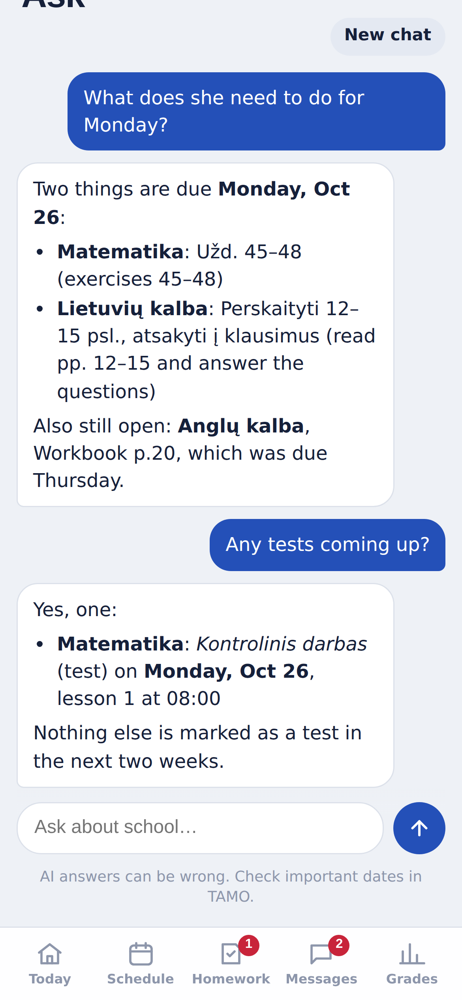
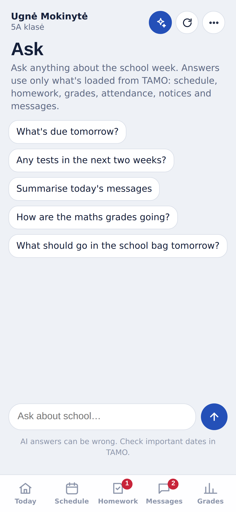

# Dienynas+

A faster, cleaner way to follow your child's school day in the **TAMO dienynas**, the Lithuanian school e-diary, built as a single [Scriptable](https://scriptable.app) script for iPhone.

The official TAMO website and app spread the important things across many screens. Dienynas+ puts what a parent checks every day on one screen: what's happening now, what to prepare for tomorrow, what homework is due, and what the school wrote today. And when you'd rather just ask, **✨ Ask** answers questions about the school week in Lithuanian or English.

  
  
  
  

> Screenshots use made-up sample data. No real pupil, teacher or school appears in them.

## Key features

### Today: the whole school day on one screen

- **Now and next.** A yellow card shows the lesson in progress with a progress bar and minutes left, or the next lesson and when it starts. It updates every minute while the app is open.
- **Today's lessons** with times, test labels (e.g. *Kontrolinis darbas*), grades and absences given in each lesson. Finished lessons fade out.
- **Get ready for the next school day.** Tomorrow's subjects (or Monday's, on a Friday) as a packing list, with any tests flagged and the homework due that day.
- **Homework to do**, today's **messages**, upcoming **tests and checks** for the next two weeks, and **what's new this week**: grades, formative assessments, absences, praise and remarks.
- School holidays and breaks appear as a banner.

 

### Schedule

- Week view with the number of lessons per day. Move between weeks with the arrows; other weeks load on demand.
- Tap any lesson to expand it: teacher, topic, homework set in that lesson, attachments (opened in-app), and the subject average.
- Each subject keeps the same colour everywhere in the app, so Matematika always looks like Matematika.

 

### Homework

- Grouped by due date: **Later**, **Later this week**, **Due tomorrow**, **Due today** and **Overdue / Earlier**, with the latest due date at the top.
- **To do / All / Done** filter. Overdue work is marked in red with how many days late it is; work due soon is highlighted.
- Shows when each assignment was set and when it's due, plus any attached files.
- Teachers' placeholder entries ("-", "x") are hidden.

 

### Messages

  
  

- **Messages per day for the last 7 days** as a bar chart. The yellow part of each bar is unread messages. Tap a day to see only that day's messages.
- Messages grouped by day (Today, Yesterday, then by date), with unread dots, attachment and importance markers. Class group messages are included.
- Tap a message to read it in a sheet; links and attachments open in-app.

### Grades

- **Subject averages for the last 30 days**, calculated from numeric grades, with a bar for each subject.
- **Grade scale per child.** Most Lithuanian schools grade 1–10, but some use 1–7. Tap **Scale 1–10** on the Grades tab (or use the ••• menu) to pick 1–10, 1–7, 1–5 or any other top grade. Each child keeps their own setting, and averages, bars and ✨ Ask all use it.
- Recent grades, formative assessments (*kaupiamieji*), and an attendance summary with absences and late arrivals.

 

### ✨ Ask: chat about the school week

  
  

Tap ✨ in the top bar and ask in your own words, in Lithuanian or English:

- *What's due tomorrow?* *Ar per dvi savaites bus kontrolinių?* *What should go in the school bag on Monday?*
- *Summarise today's messages.* *Who teaches English?* *How are the maths grades going?*

**It pulls everything first.** When you open Ask, the app gathers all the school data TAMO offers for that child and shows what the chat now knows:

- lessons for five weeks (two back, this week, two ahead), with topics, tests and notes
- all homework since 1 September, plus what was done in class over the last five weeks
- all grades, formative assessments and attendance marks since 1 September
- the school calendar, notices, and messages from the last 60 days, including the text of messages that were already read (unread ones stay unread)

The data is refreshed automatically when it's more than a few hours old or from a previous day, or any time with **Refresh data**.

**It remembers the conversation.** Every question is sent together with the whole conversation so far, so follow-ups like "and what did we decide?" work. The conversation is saved on the phone, separately for each child, and is still there next time you open the app. **Clear memory** (tap twice) deletes it and starts over.

The assistant is told to answer only from that data, never to invent dates, grades or tasks, and to say so when something isn't there. It judges grades on the child's own scale (1–10, 1–7, …). Lithuanian school text is quoted as written, with a short translation when you ask in English.

It uses the OpenAI Responses API (`gpt-5.4-mini`, low reasoning effort), the same setup as [Strava Daily Digest](https://github.com/gadominas/StravaFeed). You need your own OpenAI API key: the first time you ask, paste it once and it's saved in the iOS Keychain. You can also add or remove it from the ••• menu. API usage is billed separately from a ChatGPT subscription. Because every question carries the school data and the whole conversation, a question costs roughly a cent or two; OpenAI caches the unchanged part, which keeps follow-ups cheaper.

### Also

  
  

- **Lithuanian and English** interface, switchable in the ••• menu.
- **Dark mode** follows the iPhone setting.
- **Several children on one account:** the app asks whose diary to show and remembers the choice; switch any time from the ••• menu.
- **Home-screen widget** with the current or next lesson, homework due tomorrow and today's messages. Tapping it opens the app.
- **🔔 Scheduled checks** for new homework, grades, messages and teacher notes, shown as a popup alert or a notification (see below).
- **Works offline.** The last loaded data is shown straight away and refreshed in the background. If TAMO can't be reached, the saved data stays on screen with a note saying when it's from.
- Behaves like a native app: no pinch or double-tap zoom.

## Install

1. Install [Scriptable](https://apps.apple.com/app/scriptable/id1405459188) from the App Store.
2. In Scriptable, tap **+**, name the script `Dienynas`, and paste in the contents of [`Dienynas.js`](Dienynas.js).
3. Run it and sign in with your TAMO username and password.
4. Optional, for ✨ Ask: an OpenAI API key from [platform.openai.com](https://platform.openai.com/api-keys). Paste it the first time you ask a question.
5. Optional widget: long-press the home screen, add a **Scriptable** widget (small or medium), edit it, and choose **Dienynas** as the script.

To update, replace the script's contents with the latest `Dienynas.js`.

## 🔔 Scheduled checks: get told about anything new

Run the script on a schedule and it tells you what's new since the last check:

- 📝 new homework
- ⭐ new grades and formative assessments
- ✉️ new messages
- 🗒 teacher notes: praise, remarks, comments, absences and late marks

**If the script runs in the Scriptable app**, the news appears as a **popup alert** with an **Open** button. **If Shortcuts runs it in the background**, iOS doesn't allow alerts, so the same list arrives as a **notification**; tapping it opens the app. The text is also returned as the Shortcut output, so a **Show Alert** or **Show Result** action can display it too.

Opening the app normally also pops up anything new that arrived since the last run. Nothing is repeated: once an item has been shown, it won't come up again. The very first check only records what's already there.

**Set it up in Shortcuts:**

1. Open **Shortcuts** → **Automation** → **+** → **Time of Day** (for example 15:00 and 20:00 on school days) → **Run Immediately**.
2. Add the action **Scriptable › Run Script**, choose **Dienynas**, and set **Parameter** to `check`.
3. Choose how you want to see the news:
   - **Run In App** on: Scriptable opens and shows the popup alert.
   - **Run In App** off: it runs silently in the background and sends a notification. Allow notifications for Scriptable when iOS asks.

You can also start a check from a link or another app: `scriptable:///run/Dienynas?check=1`.

Checks cover the child currently selected in the app. Network hiccups in the background are kept quiet; you'll only get a notification about a failure when TAMO rejects the sign-in.

## How it works

Dienynas+ talks directly to the same API the official **TAMO IŠMANIEMS** mobile app uses (`api.tamo.lt` and `dienynas.tamo.lt/MobileServiceV3`) rather than scraping web pages, which makes it faster and less likely to break when the website changes.

| Data | Source |
| --- | --- |
| Sign-in | `MobileServiceV3/AuthenticateV2`, then `core/app/roles` to pick the child |
| Schedule and lesson details | `v2/app/calendar/events` (this week and next) |
| Homework | `core/app/darbai?workType=home` (3 weeks back, 4 weeks ahead) |
| Grades and attendance | `core/app/dienynas` (last 30 days) |
| What's new | `core/app/feeds` |
| Holidays and school events | `core/app/calendar/events/allDay` |
| Messages | `messaging/messages/received` and `messaging/messages/group/received` |
| Attachments | `files/filedownloadurl` / `GetFileUrl` |
| ✨ Ask | OpenAI `v1/responses`, sent only when you ask a question |

Everything is in one file. The data layer runs in Scriptable; the interface is an HTML page shown in Scriptable's WebView, and the two communicate through `tamo://` links intercepted by the script.

## Privacy and security

- Your username and password are stored only in the **iOS Keychain** on your phone. They are never written into the script.
- The script talks only to TAMO's own servers, plus OpenAI when you use ✨ Ask. There is no analytics or tracking.
- **✨ Ask sends the school data to OpenAI** with each question: lessons, homework, classwork, grades, attendance, notices, the calendar, message headers and the text of already-read messages, plus the conversation so far. The child's name isn't sent. Requests are made with `store: false`, so OpenAI doesn't keep them for later retrieval. If you don't add an OpenAI key, nothing is ever sent to OpenAI.
- Your OpenAI key is stored only in the iOS Keychain and sent only to OpenAI.
- The Ask conversation and the data gathered for it are saved in Scriptable's local documents folder, one file per child. **Clear memory** deletes that child's file.
- The last loaded data is cached in Scriptable's local documents folder so the app and widget open instantly. **Sign out and forget password** in the ••• menu deletes the credentials, the OpenAI key, the session, the cache, all saved conversations and the record of what's already been shown.
- Dienynas+ is **read-only** with one exception, the same as the official app: **opening a message marks it as read** in TAMO.

## Limitations

- **Unofficial.** This project is not affiliated with TAMO. TAMO's [terms of use](https://content.tamo.lt/taisykles/naudojimo.html) don't cover third-party clients, so use it only with your own account and at your own risk.
- Some data may require an active **TAMO IŠMANIEMS** subscription on the account.
- The API is undocumented and can change without notice. If a section fails to load, the app says which one in a red banner and shows the rest.
- Homework can't be ticked as done from the app; TAMO only allows that for pupils' own logins.
- ✨ Ask can be wrong like any AI assistant. Check important dates in TAMO.
- A very long conversation can eventually exceed what the AI can read at once. The app then asks you to **Clear memory**.

## Credits

- [sobakintech/tamo-dienynas-api](https://github.com/sobakintech/tamo-dienynas-api) (MIT): the reverse-engineered TAMO API reference this app is built on.
- [sobakintech/tamo-dienynas-mcp](https://github.com/sobakintech/tamo-dienynas-mcp) (AGPL-3.0): response-mapping approach that the data layer's mappers are adapted from.
